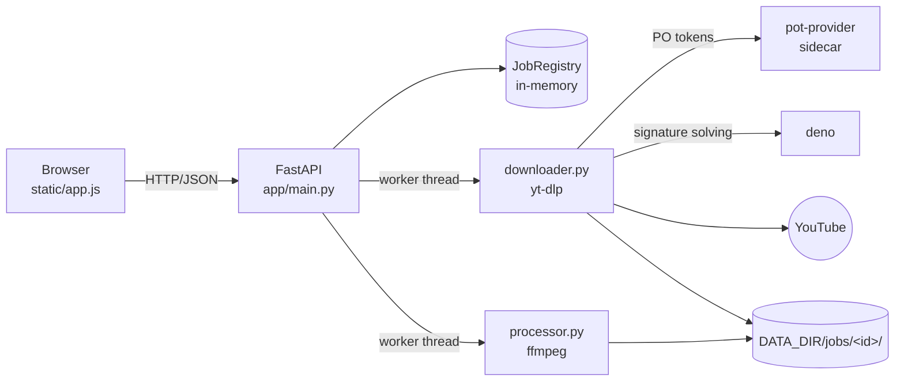
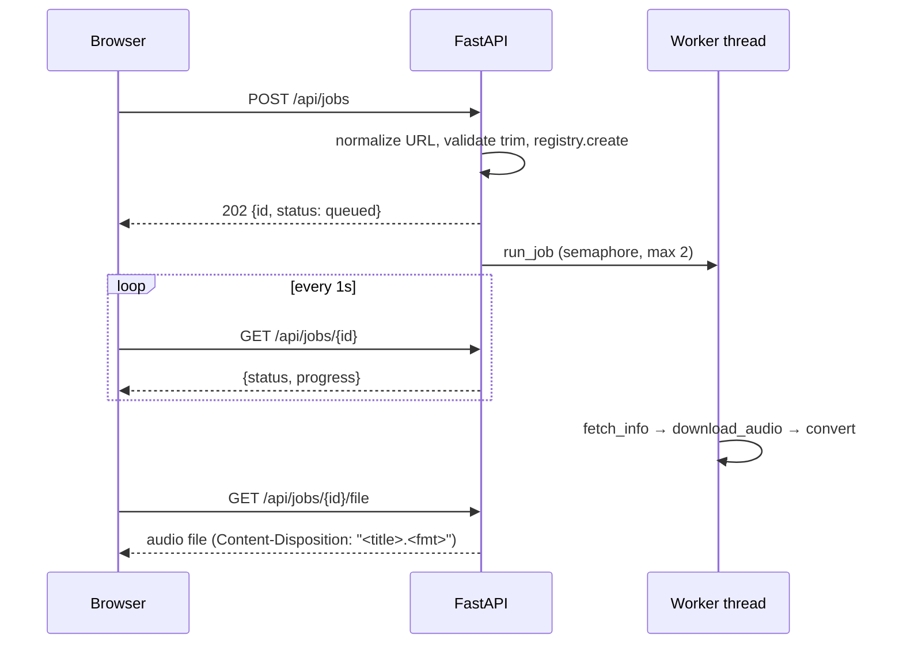
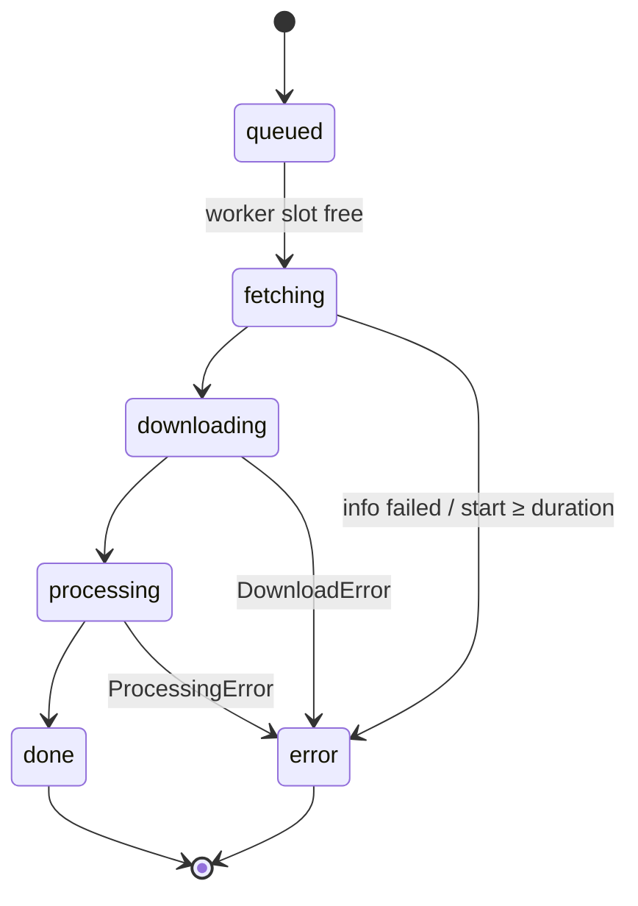

# Architecture

TubeTrim is deliberately small: one Python process, no database, no queue, no frontend build. This page explains how the parts fit together and why.

## Components

| Module | Responsibility | Notes |
|---|---|---|
| `main.py` | HTTP routes, job orchestration, startup cleanup | The only module that knows about HTTP |
| `urls.py` | Turn any accepted YouTube URL form into `https://www.youtube.com/watch?v=<ID>` | Pure function, no I/O |
| `downloader.py` | `fetch_info` (metadata only) and `download_audio` | Wraps every yt-dlp error in `DownloadError` with a user-presentable message |
| `processor.py` | `convert` (trim + transcode) and `probe_duration` | Shells out to `ffmpeg`/`ffprobe` with list args (never `shell=True`) |
| `jobs.py` | `Job` dataclass and `JobRegistry` | A dict behind a `threading.Lock`; module-level singleton `registry` |
| `schemas.py` | Pydantic models and `JobStatus` | The API contract |

## Request flow

The UI makes two kinds of calls:

1. **Preview.** As the user types a URL (debounced 600ms), `POST /api/info` runs `fetch_info` synchronously in a worker thread and returns title, duration, and thumbnail. Nothing is stored.
2. **Convert.** `POST /api/jobs` validates input, creates a `Job`, spawns a background task, and returns `202` immediately. The UI then polls `GET /api/jobs/{id}` every second and, when it's `done`, links to `GET /api/jobs/{id}/file`.

## Job lifecycle

Progress is a single 0–100 number across all stages:

| Stage | `progress` |
|---|---|
| `queued`, `fetching` | 0 |
| `downloading` | 5 → 70 (yt-dlp's 0–100 is mapped onto this range; it only moves if yt-dlp reports a total size) |
| `processing` | 75 (ffmpeg progress is not tracked) |
| `done` | 100 |

Trim handling in the runner: `end` past the video's duration is clamped to the duration; `start` at or past the duration fails the job with *"Trim start is beyond video length"*.

## Concurrency model

- Routes are `async`. Every blocking call (yt-dlp, ffmpeg) goes through `anyio.to_thread.run_sync` so the event loop never blocks.
- `run_job` acquires a module-level `asyncio.Semaphore(2)`, so **at most two jobs run at once**; extra jobs sit in `queued`.
- Background tasks are kept in the `_tasks` set so they aren't garbage-collected mid-flight.
- `JobRegistry` methods lock, but `get()` returns the live `Job` object and readers then access its fields without the lock. That's why `_run_job_sync` sets `out_path` **in the same update as, and before,** `status=done`: a reader that sees `done` must also see the file path. Preserve this ordering if you touch the runner.

## Storage and lifetime

- Each job works in `DATA_DIR/jobs/<uuid>/`: yt-dlp writes `source.<ext>`, ffmpeg writes `out.<fmt>`.
- **Job state is in memory only.** Restarting the process forgets every job; their files stay on disk.
- On **startup only**, job directories with an mtime older than 24h are deleted. A long-running process never sweeps, so disk usage grows until the next restart (see [Troubleshooting](troubleshooting.md#disk-filling-up)).

## Why yt-dlp needs three moving parts

YouTube actively resists downloaders, so yt-dlp alone isn't enough:

1. **yt-dlp** (Python library, plus `yt-dlp-ejs`): extraction. Unpinned on purpose (`>=`), because staying current is the main defence against breakage.
2. **deno** (copied into the image): a JS runtime yt-dlp uses to solve YouTube's signature challenges.
3. **pot-provider** sidecar + the `bgutil-ytdlp-pot-provider` plugin: supplies Proof-of-Origin tokens. Without them YouTube returns 403 for most stream URLs.

As an extra fallback, `download_audio` retries once with yt-dlp's `web_embedded` player client if the first attempt fails with a 403, deleting any partial file first.

## Deliberate non-goals

Playlists, video output, authentication, persistent history, multi-user support, and rate limiting are out of scope. This is a personal, self-hosted tool. In particular, **there is no auth**, so never expose it directly to the internet.

Next: [API reference](api.md).
